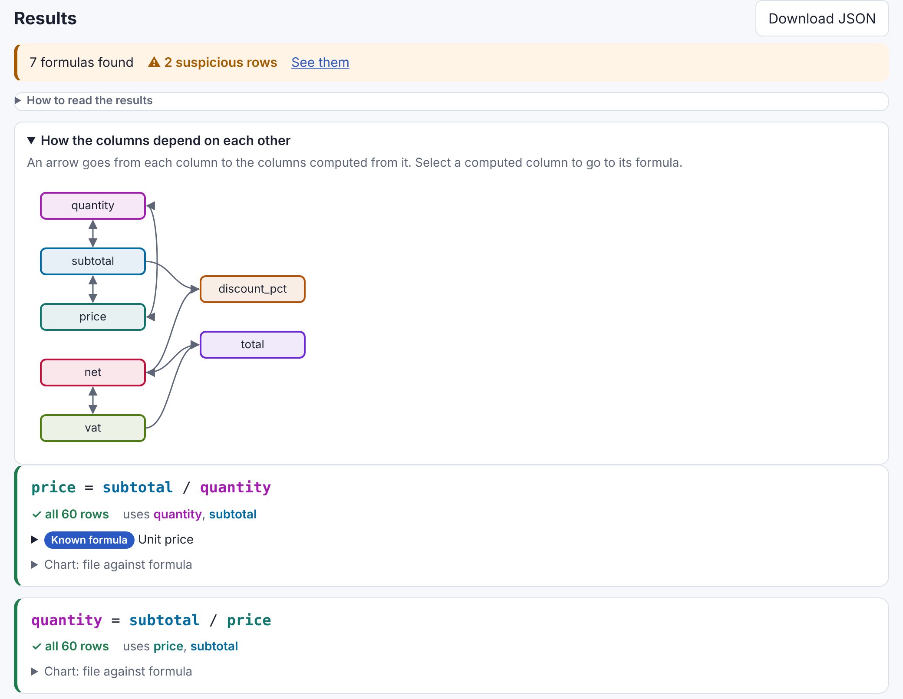

# Regrex

[](https://github.com/dabupr/regrex/actions/workflows/ci.yml)
[](https://pypi.org/project/pyregrex/)
[](https://crates.io/crates/regrex-cli)
[](LICENSE)

**Find the formula behind your data.** Regrex is an open-source symbolic regression engine written in Rust that runs in your browser (WebAssembly, no server), in Python and as a tool for AI agents.

**[Try it in your browser →](https://dabupr.github.io/regrex/)** Nothing to install, and your data never leaves your computer.



## Install

```sh
pip install pyregrex          # Python package (import regrex)
cargo install regrex-cli      # the regrex command line tool
```

Prebuilt `regrex` binaries for Linux, macOS and Windows are attached to each [GitHub release](https://github.com/dabupr/regrex/releases). The web app needs no install.

> Regrex is before 1.0: new versions may still change the API. See the [roadmap](docs/ROADMAP.md) and the [changelog](CHANGELOG.md).

## What it does

- **Scan a dataset**: upload a CSV or Excel file and Regrex tells you which columns are computed from others, and with which formula (for example `Total = Price × Quantity × 1.21`), plus the rows that do not follow it.
- **Ranked candidate formulas**: ordered by error and complexity, with a prior that depends on the domain (physics, maths, signals, computing, finance).
- **Any table, not just formulas between columns**: it works out what each column is for (groups, order, categories, codes), finds formulas that change with a text column (one per curve type, a VAT rate per country), formulas between consecutive rows (a running total, a chainage), numbers hidden in text, relations between text columns and relations between two files.
- **Units and dimensional analysis** to prune impossible formulas.
- **"Known formula" badge** when a candidate matches an established formula (kinetic energy, Ohm's law, VAT, compound interest…). Browse the [library of known formulas](https://dabupr.github.io/regrex/library.html).
- **Error diagnosis per row**: given the correct formula, explain what each wrong result did (forgot a square, used g = 10, swapped two parameters, cm vs m).
- **Built for AI**: MCP server, stable JSON output and a compact report for agents to judge the results. No AI inside: the same file always gives the same answer. The AI proposes, the engine verifies.
- **Private by design**: in the browser, your data never leaves your computer.

## Web app

Open [dabupr.github.io/regrex](https://dabupr.github.io/regrex/), drop a CSV, Excel or JSON file, or paste cells copied from a spreadsheet (or try the example), untick ID columns and press **Find derived columns**. Each formula appears as soon as it is found, and every column shows whether it is found, being searched or still to do; on large files a quick look at a sample comes first, then each formula is checked on all rows. Each column keeps its own colour in the formulas, the tables and the dependency graph. Rows that break a formula are listed with the cell to fix highlighted, and can be exported as CSV. A second file can be added to find relations between the two, and every search setting is explained where it is set. The engine is the same Rust code as the command line, compiled to WebAssembly and run in a background thread, so files are never uploaded anywhere.

## Command line

Find the columns of a spreadsheet that are computed from other columns, and the rows that break the rule:

```console
$ regrex scan examples/data/invoices.csv --ignore invoice
examples/data/invoices.csv: 60 rows, 7 numeric columns
Text read as categories: product
Regimes: product, quantity, discount_pct.

  price        = subtotal / quantity          60/60 rows
                 known formula: Unit price
  quantity     = subtotal / price             60/60 rows
  discount_pct = 100 - 100 * net / subtotal   60/60 rows
                 known formula: Speed improvement in percent
  subtotal     = price * quantity             60/60 rows
                 known formula: Line total (price × quantity)
  net          = total - vat                  59/60 rows   exception: row 17 is 73.8, formula gives 78.8 (the total in this row looks wrong, it breaks its own formula too)
  vat          = 0.21 * net                   59/60 rows   exception: row 42 is 29.97, formula gives 62.937 (used 0.1 instead of 0.21)
                 known formula: Tax amount with t = 0.21
  total        = net + vat                    59/60 rows   exception: row 17 is 94.3, formula gives 89.3
```

- Explains each exception when a simple mistake reproduces it exactly: a wrong constant (VAT at 10%, `g = 10`), a mistyped digit, a unit or percentage factor, a forgotten square, swapped or wrong columns, a missing term, or another wrong cell in the same row.
- Reads CSV (comma, semicolon or tab; decimal point or comma), spreadsheets (`.xlsx`, `.xls`, `.ods`, choose one with `--sheet`) JSON (`.json` with an array of objects or an object of columns, `.ndjson`/`.jsonl` with one object per line), Parquet (`.parquet`), Arrow IPC (`.arrow`, `.feather`) and SQLite databases (`.sqlite`, `.db`, choose the table with `--sheet`). The last three are a default cargo feature of the CLI (`--no-default-features` leaves them out); the web app reads them too, loading each reader only when such a file is opened.
- Cells that are not plain numbers are read too: `true`/`false`, times (`08:15`, as minutes), dates (`2026-10-15`, `15/10/2026`, Kibana's `Oct 15, 2026 @ 14:24:47.000`) and numbers with a unit (`24.1 km`); `-`, `NA` and `null` count as empty. So a delay is found as `actual_arrival - arrival`.
- Codes built from other numbers are found too, with integer division and remainder: `line = service div 100`, `car = 1 + train mod 4`.
- Put units in the headers (`time (s)`, `distance [m]`) and Regrex skips formulas that mix incompatible units, which is faster and avoids nonsense like adding seconds to metres.
- Works out what each column is for (group keys, the order of the rows, categories, codes, measurements) and uses it: formulas that change with a text column (`cant` is 0 on straights, constant on each curve and a ramp along the chainage on transitions), formulas between consecutive rows (a running total, a chainage that grows by the distance between points, a gradient as the slope of a height), rates per category (VAT per country), numbers hidden in text (`GIS5550`, `1/8,5`, `POINT (x y)`) and relations between text columns (`key = line + "|" + track`, a code per name).
- `--with other.csv` reads a second file and matches its rows with those of the first on the columns both have, such as a line, a track and a chainage, so the scan finds the relations between the two files (a measured radius that equals the designed one on circular curves). When the files share no such columns but both give coordinates (`x`/`y` columns or a WKT `POINT`), each row of the smaller file is matched to the nearest point of the other: switches given as points get the track and chainage they sit on.
- `--quick` searches every column on a sample of rows (blocks spread over the file), prints each formula as soon as it is found there, and confirms it on all rows: several times faster on large files.
- `regrex describe data.csv` tells what a table holds without searching: each column's role, values and range, the groups and order of the rows and the relations between text columns, in about the time it takes to read the file.
- `--json` prints a stable, versioned JSON report for scripts and AI agents ([format](docs/json-output.md)).
- `--mermaid` prints the dependencies between columns as a diagram.
- `--agent` prints a compact JSON report for AI agents to judge the results: every column (text or number, distinct values, range), each formula with its errors, the near misses and the inputs tried for the columns left unexplained ([format](docs/json-output.md#agent-report)). The MCP server gives it with `"format": "agent"`.
- `--verbose` tells on stderr what the search does for each column: the inputs it tries, the best formula so far and how it ended.
- Formulas that hold on many rows but not enough to be reported, or only where another column has some values, are listed apart under "Almost" (`near_misses` in the JSON): they often show that a column follows different rules in different groups of rows.
- `regrex fit data.csv --target y` lists candidate formulas for a single column.

Install with `cargo install regrex-cli`, download a binary from the [releases](https://github.com/dabupr/regrex/releases), or build from source with `cargo install --path crates/regrex-cli`.

## Python

```python
import regrex

report = regrex.scan_file("examples/data/invoices.csv", ignore=["invoice"])
for d in report["derived"]:
    print(d["column"], "=", d["formula"], d["exception_rows"])

regrex.describe_file("track.parquet")                         # roles, groups, order; no search
regrex.scan_file("track.parquet", with_="design.csv", quick=True)

best = regrex.search({"m": m, "v": v}, energy)[0]   # also takes pandas DataFrames
print(best["formula"])                                # 0.5 * m * v^2
```

Install with `pip install pyregrex` (wheels for Linux, macOS and Windows, Python 3.9 and later), or from source with `pip install ./crates/regrex-py` (needs a Rust toolchain). See the [Python README](crates/regrex-py/README.md).

## AI assistants (MCP)

`regrex mcp` is a [Model Context Protocol](https://modelcontextprotocol.io) server, so Claude, Cursor, VS Code and other assistants can scan your files, fit formulas and check units with a real engine instead of guessing. With Claude Code:

```sh
claude mcp add regrex -- regrex mcp
```

See [docs/mcp.md](docs/mcp.md) for other clients and the list of tools, and [docs/json-output.md](docs/json-output.md) for the output format.

## Rust library

The engine is a Rust library (`regrex-core` on crates.io; `regrex-io` reads files and writes reports):

```rust
use regrex_core::{search, SearchConfig};

let mass = vec![1.0, 2.5, 4.0, 0.8, 7.2, 3.3];
let speed = vec![3.0, 1.2, 7.5, 12.0, 0.6, 4.4];
let energy: Vec<f64> = mass.iter().zip(&speed).map(|(m, v)| 0.5 * m * v * v).collect();

let results = search(&[mass, speed], &energy, &SearchConfig::default()).unwrap();
let names = ["m".to_string(), "v".to_string()];
println!("{}", results[0].expr.display_with(&names)); // 0.5 * m * v^2
```

Or run the example: `cargo run --release --example basic`. On 24 equations from the Feynman Lectures it recovers 21 without noise and 20 with 1% noise; see [docs/BENCHMARKS.md](docs/BENCHMARKS.md).

## Development

```sh
cargo test --workspace

# Python bindings
pip install maturin pytest
cd crates/regrex-py && maturin develop && pytest

# Web app
cd web && npm ci && npm run build && npm test
```

## Contributing

Issues and pull requests are welcome. Read [CONTRIBUTING.md](CONTRIBUTING.md) to get started and the [Code of Conduct](CODE_OF_CONDUCT.md) before taking part. Report security issues privately as described in [SECURITY.md](SECURITY.md).

## Citing

If you use Regrex in research, please cite it using [CITATION.cff](CITATION.cff) (GitHub shows a "Cite this repository" button).

## License

MIT
