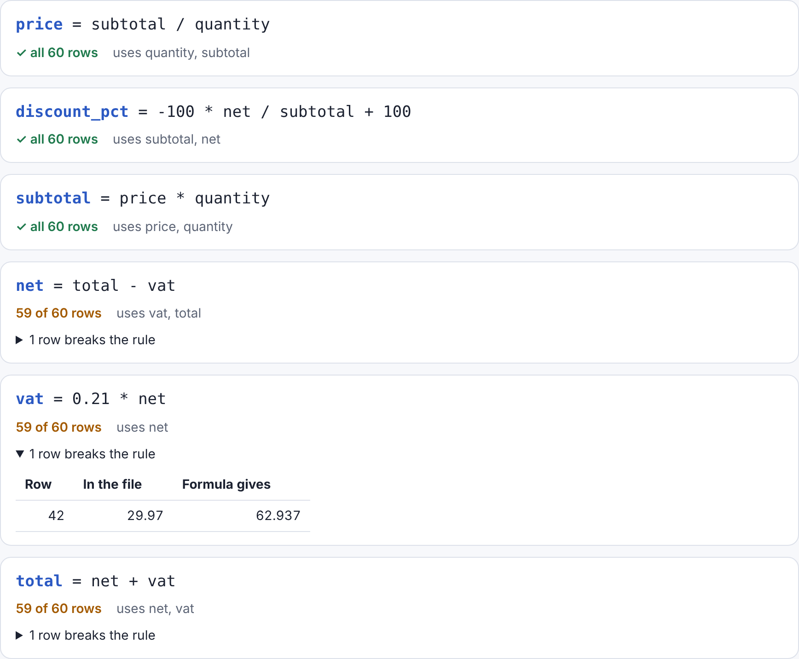

# Regrex

[](https://github.com/dabupr/regrex/actions/workflows/ci.yml)
[](LICENSE)

**Find the formula behind your data.** Regrex is an open-source symbolic regression engine written in Rust that runs in your browser (WebAssembly, no server), in Python and as a tool for AI agents.

**[Try it in your browser →](https://dabupr.github.io/regrex/)** Nothing to install, and your data never leaves your computer.



> Status: early development. The engine is being built in the open; see the [roadmap](docs/ROADMAP.md).

## What it will do

- **Scan a dataset**: upload a CSV or Excel file and Regrex tells you which columns are computed from others, and with which formula (for example `Total = Price × Quantity × 1.21`), plus the rows that do not follow it.
- **Ranked candidate formulas**: ordered by error and complexity, with a prior that depends on the domain (physics, maths, signals, computing, finance).
- **Units and dimensional analysis** to prune impossible formulas.
- **"Known formula" badge** when a candidate matches an established formula (kinetic energy, Ohm's law, VAT, compound interest…). Browse the [library of known formulas](https://dabupr.github.io/regrex/library.html).
- **Error diagnosis per row**: given the correct formula, explain what each wrong result did (forgot a square, used g = 10, swapped two parameters, cm vs m).
- **Built for AI**: MCP server and stable JSON output. The AI proposes, the engine verifies.
- **Private by design**: in the browser, your data never leaves your computer.

## Web app

Open [dabupr.github.io/regrex](https://dabupr.github.io/regrex/), drop a CSV, Excel or JSON file, or paste cells copied from a spreadsheet (or try the example), untick ID columns and press **Find derived columns**. Rows that break a formula are listed at the top with the cell to fix highlighted, and can be exported as CSV. The engine is the same Rust code as the command line, compiled to WebAssembly and run in a background thread, so files are never uploaded anywhere.

## Command line

Find the columns of a spreadsheet that are computed from other columns, and the rows that break the rule:

```console
$ regrex scan examples/data/invoices.csv --ignore invoice
examples/data/invoices.csv: 60 rows, 7 numeric columns
Skipped (not numeric): product

  price        = subtotal / quantity          60/60 rows
  discount_pct = 100 - 100 * net / subtotal   60/60 rows
  subtotal     = price * quantity             60/60 rows
  net          = total - vat                  59/60 rows   exception: row 17 is 73.8, formula gives 78.8 (the total in this row looks wrong, it breaks its own formula too)
  vat          = 0.21 * net                   59/60 rows   exception: row 42 is 29.97, formula gives 62.937 (used 0.1 instead of 0.21)
  total        = net + vat                    59/60 rows   exception: row 17 is 94.3, formula gives 89.3
```

- Explains each exception when a simple mistake reproduces it exactly: a wrong constant (VAT at 10%, `g = 10`), a mistyped digit, a unit or percentage factor, a forgotten square, swapped or wrong columns, a missing term, or another wrong cell in the same row.
- Reads CSV (comma, semicolon or tab; decimal point or comma), spreadsheets (`.xlsx`, `.xls`, `.ods`, choose one with `--sheet`) JSON (`.json` with an array of objects or an object of columns, `.ndjson`/`.jsonl` with one object per line), Parquet (`.parquet`), Arrow IPC (`.arrow`, `.feather`) and SQLite databases (`.sqlite`, `.db`, choose the table with `--sheet`). The last three are a default cargo feature of the CLI (`--no-default-features` leaves them out) and are not available in the web app.
- Put units in the headers (`time (s)`, `distance [m]`) and Regrex skips formulas that mix incompatible units, which is faster and avoids nonsense like adding seconds to metres.
- `--json` prints a stable, versioned JSON report for scripts and AI agents ([format](docs/json-output.md)).
- `--mermaid` prints the dependencies between columns as a diagram.
- `regrex fit data.csv --target y` lists candidate formulas for a single column.

Install from source with `cargo install --path crates/regrex-cli`. From the first release on, prebuilt binaries are attached to each [GitHub release](https://github.com/dabupr/regrex/releases) and `cargo install regrex-cli` works too.

## Python

```python
import regrex

report = regrex.scan_file("examples/data/invoices.csv", ignore=["invoice"])
for d in report["derived"]:
    print(d["column"], "=", d["formula"], d["exception_rows"])

best = regrex.search({"m": m, "v": v}, energy)[0]   # also takes pandas DataFrames
print(best["formula"])                                # 0.5 * m * v^2
```

Install from source with `pip install ./crates/regrex-py` (needs a Rust toolchain); from the first release on, `pip install pyregrex`. See the [Python README](crates/regrex-py/README.md).

## AI assistants (MCP)

`regrex mcp` is a [Model Context Protocol](https://modelcontextprotocol.io) server, so Claude, Cursor, VS Code and other assistants can scan your files, fit formulas and check units with a real engine instead of guessing. With Claude Code:

```sh
claude mcp add regrex -- regrex mcp
```

See [docs/mcp.md](docs/mcp.md) for other clients and the list of tools, and [docs/json-output.md](docs/json-output.md) for the output format.

## Rust library

The engine can already rediscover formulas from data (Rust library, phase 1 of the roadmap):

```rust
use regrex_core::{search, SearchConfig};

let mass = vec![1.0, 2.5, 4.0, 0.8, 7.2, 3.3];
let speed = vec![3.0, 1.2, 7.5, 12.0, 0.6, 4.4];
let energy: Vec<f64> = mass.iter().zip(&speed).map(|(m, v)| 0.5 * m * v * v).collect();

let results = search(&[mass, speed], &energy, &SearchConfig::default()).unwrap();
let names = ["m".to_string(), "v".to_string()];
println!("{}", results[0].expr.display_with(&names)); // 0.5 * m * v^2
```

Or run the example: `cargo run --release --example basic`. On 24 equations from the Feynman Lectures it recovers 21 without noise and 20 with 1% noise; see [docs/BENCHMARKS.md](docs/BENCHMARKS.md).

## Development

```sh
cargo test --workspace

# Python bindings
pip install maturin pytest
cd crates/regrex-py && maturin develop && pytest

# Web app
cd web && npm ci && npm run build && npm test
```

## Contributing

Issues and pull requests are welcome. Read [CONTRIBUTING.md](CONTRIBUTING.md) to get started and the [Code of Conduct](CODE_OF_CONDUCT.md) before taking part. Report security issues privately as described in [SECURITY.md](SECURITY.md).

## Citing

If you use Regrex in research, please cite it using [CITATION.cff](CITATION.cff) (GitHub shows a "Cite this repository" button).

## License

MIT
